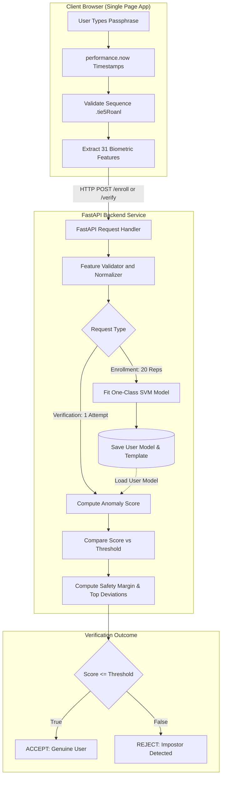

# Keyro: Keystroke Dynamics Biometric Authentication

[](https://www.python.org/downloads/)
[](https://fastapi.tiangolo.com/)
[](https://scikit-learn.org/)
[](https://opensource.org/licenses/MIT)
[](tests/)
[](results/)
[](results/)

Keyro is an end-to-end behavioral biometric authentication system powered by keystroke dynamics. Rather than authenticating users solely on what they type (knowledge-based factor), Keyro validates how they type (behavioral biometric factor). By recording millisecond-precision neuromuscular timing patterns, Keyro extracts 31 temporal features from the benchmark passphrase `.tie5Roanl` and detects unauthorized impostors using trained one-class anomaly detection models.

```
+-----------------------------------------------------------------------------+
|                                KEYRO MATRIX                                 |
|                                                                             |
|   Password Input (".tie5Roanl") + Neuromuscular Latency (31 Features)       |
|                                     |                                       |
|                                     v                                       |
|                  One-Class SVM / Scaled Manhattan / IForest                 |
|                                     |                                       |
|                   +-----------------+-----------------+                     |
|                   |                                   |                     |
|                   v                                   v                     |
|            [ GENUINE USER ]                    [ IMPOSTOR ]                 |
|          Score <= Threshold                 Score > Threshold               |
|            Access Granted                     Access Denied                 |
+-----------------------------------------------------------------------------+
```

---

## Table of Contents

- [Keyro: Keystroke Dynamics Biometric Authentication](#keyro-keystroke-dynamics-biometric-authentication)
  - [Table of Contents](#table-of-contents)
  - [Core Concept and Value Proposition](#core-concept-and-value-proposition)
  - [Dataset Description](#dataset-description)
  - [The 31 Neuromuscular Biometric Features](#the-31-neuromuscular-biometric-features)
  - [Machine Learning Models and Evaluation Metrics](#machine-learning-models-and-evaluation-metrics)
    - [Evaluation Metrics Defined](#evaluation-metrics-defined)
    - [Benchmark Evaluation Protocol](#benchmark-evaluation-protocol)
    - [Comprehensive Benchmark Results across 51 Subjects](#comprehensive-benchmark-results-across-51-subjects)
    - [Why One-Class SVM Outperformed Competing Models](#why-one-class-svm-outperformed-competing-models)
    - [Evaluation Artifacts and Visualizations](#evaluation-artifacts-and-visualizations)
  - [System Architecture](#system-architecture)
  - [Live Web Application Features](#live-web-application-features)
  - [REST API Reference](#rest-api-reference)
  - [Project Directory Structure](#project-directory-structure)
  - [Quickstart and Installation](#quickstart-and-installation)
    - [1. Prerequisites](#1-prerequisites)
    - [2. Clone Repository and Install Dependencies](#2-clone-repository-and-install-dependencies)
    - [3. Run the Offline Benchmark Pipeline](#3-run-the-offline-benchmark-pipeline)
    - [4. Launch the Live Web Server](#4-launch-the-live-web-server)
  - [Automated Testing](#automated-testing)
  - [Real-World Edge Cases and Security Limitations](#real-world-edge-cases-and-security-limitations)
  - [Research Citation and License](#research-citation-and-license)

---

## Core Concept and Value Proposition

Standard password security suffers from systemic flaws:
- Phishing, keylogging, and credential stuffing compromise plaintext passwords.
- Password reuse exposes accounts across multiple external services.
- Binary verification models treat anyone holding the plaintext password as the authorized owner.

Keystroke dynamics bridges this vulnerability without requiring proprietary hardware like fingerprint readers or retina scanners. Because subconscious muscle memory, finger travel kinematics, and dwell latencies are unique to each individual, two people typing the exact same passphrase produce measurably distinct timing signatures. Keystroke dynamics delivers transparent two-factor security within a single factor.

---

## Dataset Description

Keyro is developed and validated against the benchmark keystroke dataset collected by Kevin S. Killourhy and Roy A. Maxion at Carnegie Mellon University (CMU):

- **Dataset Identifier**: CMU Keystroke Dynamics Benchmark (`DSL-StrongPasswordData.csv`)
- **Citation**: Killourhy, K. S., and Maxion, R. A. (2009). *Comparing anomaly-detection algorithms for keystroke dynamics*. IEEE/IFIP International Conference on Dependable Systems & Networks.
- **Typing Subjects**: 51 unique human typists.
- **Passphrase**: Fixed string `.tie5Roanl` followed by Enter (`Return`) (11 key strokes total).
- **Repetitions**: 400 repetitions per subject across 8 independent recording sessions (50 repetitions per session spaced over several weeks to capture authentic intra-subject longitudinal drift).
- **Total Dataset Size**: 20,400 raw typing records with 34 columns (3 identifier metadata fields + 31 numeric timing features).
- **Timestamp Unit**: Floating-point seconds with microsecond resolution (e.g., `0.1491 s = 149.1 ms`).
- **Passphrase Design Rationale**: The sequence `.tie5Roanl` was engineered by CMU researchers to evaluate varied hand movements: punctuation (`.`), alternating lowercase letters (`t`, `i`, `e`), a numeric character (`5`), a capitalized letter requiring the Shift modifier (`R`), and return transition to lowercase (`o`, `a`, `n`, `l`) terminated by `Return`.

---

## The 31 Neuromuscular Biometric Features

For every password entry, the client captures keydown and keyup timestamps with high-resolution browser clocks (`performance.now()`). The 31 features map to three temporal dimensions:

1. **Hold Times ($H.k$, 11 Features)**:
   The duration a single key remains depressed from initial press down to release:
   $$H.k = t_{\text{up}}(k) - t_{\text{down}}(k)$$
   Evaluated for: `.`, `t`, `i`, `e`, `5`, `Shift.r`, `o`, `a`, `n`, `l`, `Return`.

2. **Down-Down Flight Times ($DD.k_1.k_2$, 10 Features)**:
   The elapsed interval between depressing key $k_1$ and depressing the subsequent key $k_2$:
   $$DD.k_1.k_2 = t_{\text{down}}(k_2) - t_{\text{down}}(k_1)$$
   Evaluated for: `period.t`, `t.i`, `i.e`, `e.five`, `five.Shift.r`, `Shift.r.o`, `o.a`, `a.n`, `n.l`, `l.Return`.

3. **Up-Down Flight Times ($UD.k_1.k_2$, 10 Features)**:
   The inter-key transition gap between releasing key $k_1$ and depressing key $k_2$:
   $$UD.k_1.k_2 = t_{\text{down}}(k_2) - t_{\text{up}}(k_1)$$
   Evaluated for: `period.t`, `t.i`, `i.e`, `e.five`, `five.Shift.r`, `Shift.r.o`, `o.a`, `a.n`, `n.l`, `l.Return`.

Mathematical consistency rule:
$$DD.k_1.k_2 = H.k_1 + UD.k_1.k_2$$

---

## Machine Learning Models and Evaluation Metrics

Keystroke biometric verification is formulated as an **open-set anomaly detection** task. In production, a server possesses genuine typing samples for an enrolled user, but cannot anticipate the typing profiles of future attackers.

We implement and evaluate three distinct one-class classifiers:

1. **One-Class Support Vector Machine (One-Class SVM)**:
   Constructs a non-linear bounding hypersphere in reproducing kernel Hilbert space (RKHS) using a Radial Basis Function (RBF) kernel:
   $$K(x, x') = \exp(-\gamma \|x - x'\|^2)$$
   With $\nu = 0.05$ and `gamma='scale'`. The anomaly score is defined as $-\text{decision\_function}(x)$.

2. **Scaled Manhattan Baseline**:
   Computes mean vector $\mu$ and standard deviation vector $\sigma$ from genuine training vectors. The anomaly score is the normalized $L_1$ distance:
   $$\text{Score}_{\text{Manhattan}}(x) = \frac{1}{D} \sum_{j=1}^D \frac{|x_j - \mu_j|}{\sigma_j + \epsilon}$$

3. **Isolation Forest**:
   Ensemble of 100 randomized decision trees isolating anomalies at shorter tree path depths. The anomaly score is defined as $-\text{score\_samples}(x)$.

### Evaluation Metrics Defined

- **False Acceptance Rate (FAR)**: The percentage of zero-effort impostor attempts incorrectly accepted by the classifier ($\text{score} \le \theta$). Lower indicates stronger security against attackers.
- **False Rejection Rate (FRR)**: The percentage of authentic genuine attempts incorrectly rejected ($\text{score} > \theta$). Lower indicates greater user convenience.
- **Equal Error Rate (EER)**: The operational threshold $\theta^*$ where FAR equals FRR:
  $$\text{EER} = \text{FAR}(\theta^*) = \text{FRR}(\theta^*)$$
  EER serves as the standard single-number benchmark metric in biometric systems research.
- **Area Under ROC Curve (AUC-ROC)**: Measures general discrimination performance across all possible decision thresholds, independent of operational operating point selection.
- **Detection Error Tradeoff (DET)**: Visualizes FRR versus FAR on logarithmic scale axes, demonstrating performance trade-offs under high-security and high-convenience constraints.

### Benchmark Evaluation Protocol

Following the experimental protocol established by Killourhy and Maxion (2009):
- **Subjects Evaluated**: All 51 subjects in `DSL-StrongPasswordData.csv`.
- **Genuine Training Set**: The first 200 repetitions of subject $S$ ($rep \le 200$).
- **Genuine Test Set**: The remaining 200 repetitions of subject $S$ ($rep > 200$).
- **Impostor Test Set**: The first 5 test repetitions from every other subject $S' \ne S$ ($50 \times 5 = 250$ impostor attempts per subject).
- **Total Test Trials**: 450 evaluation attempts per subject ($51 \times 450 = 22,950$ total evaluations across the benchmark).

### Comprehensive Benchmark Results across 51 Subjects

| Model / Anomaly Detector | Mean EER (%) | Std EER (%) | Median EER (%) | Mean AUC | Mean FAR (%) | Mean FRR (%) | Benchmark Rank |
| :--- | :---: | :---: | :---: | :---: | :---: | :---: | :---: |
| **One-Class SVM (RBF)** | **14.12%** | **± 9.54%** | **11.35%** | **0.9113** | **14.12%** | **14.12%** | **Best Model** |
| **Scaled Manhattan Baseline** | 14.34% | ± 10.21% | 11.80% | 0.9118 | 14.33% | 14.34% | Runner-up |
| **Isolation Forest** | 15.15% | ± 9.97% | 12.85% | 0.9097 | 15.15% | 15.15% | Evaluated |

### Why One-Class SVM Outperformed Competing Models

1. **Non-linear Boundary Modeling**: Typing dynamics are non-linearly correlated across finger transitions. The RBF kernel encloses complex spatial geometries that linear models fail to capture.
2. **Robust Outlier Regularization**: Setting $\nu = 0.05$ prevents accidental typing slips or minor pauses during enrollment from distorting the support vectors.
3. **Lowest Standard Deviation (±9.54%)**: One-Class SVM demonstrated consistent performance across both fast burst typists and methodical slow typists.
4. **Subject Variability Highlights**: For rhythmic typists (such as subject `s005`), One-Class SVM achieved an outstanding **6.0% EER** with **0.9844 AUC**. For typists with high cadence entropy (such as subject `s007`), the EER rose to **30.65%**, illustrating authentic biological differences in neuromuscular consistency.

### Evaluation Artifacts and Visualizations

The offline benchmark automatically exports generated publication-ready plots to the `results/` folder:

- `results/roc_curves.png`: Mean ROC curve across all 51 subjects displaying an overall AUC of 0.9113.
- `results/det_curves.png`: Detection Error Tradeoff plot illustrating the log-scale trade-off between False Alarms and Miss Probabilities.
- `results/model_comparison.png`: Bar chart contrasting Mean EER and standard deviation error bars for One-Class SVM, Scaled Manhattan, and Isolation Forest.
- `results/benchmark_summary.json`: Granular per-subject and aggregate metrics for all evaluated models.
- `results/best_model_config.json`: Production hyperparameter configuration used by the live FastAPI server.

---

## System Architecture



---

## Live Web Application Features

The single-page web interface (`app/static/index.html`) is built with responsive vanilla JavaScript and a curated dark glassmorphism design system:

1. **User Enrollment Workspace**:
   - Register a username and type `.tie5Roanl` 20 times.
   - Real-time cadence timeline displays Hold and Flight durations for each attempt.
   - Fits a custom One-Class SVM model and generates reference templates.

2. **Live Biometric Verification Workspace**:
   - Type `.tie5Roanl` and press Enter.
   - Real-time verdict banner: **ACCEPT** (emerald glow) or **REJECT** (ruby red).
   - Radial metric dials display Anomaly Score, Decision Threshold, Safety Margin, and Confidence Percentage.

3. **Interactive Threshold Slider**:
   - Adjust the classification threshold live between Strict Mode and High-Convenience Mode.
   - Instantly updates simulated FAR vs FRR trade-offs for varied risk profiles (e.g. wire transfer vs casual unlock).

4. **Friend Impersonator Challenge**:
   - Select an enrolled profile and invite a colleague to type the exact password `.tie5Roanl`.
   - The colleague enters the identical characters, but their distinct hand rhythm triggers an authentication failure.
   - Logs adversarial attempts in an audit trail table with feature discrepancy analysis.

5. **Key Deviations Breakdown**:
   - Displays a millisecond-level breakdown of which specific key transitions deviated furthest from the genuine template.

---

## REST API Reference

| Method | Endpoint | Description | Request Body | Response Body |
| :--- | :--- | :--- | :--- | :--- |
| `GET` | `/health` | Server health and target passphrase | None | `{"status": "ok", "service": "keyro", "passphrase": ".tie5Roanl"}` |
| `GET` | `/` | Serves the web interface | None | HTML document (`index.html`) |
| `POST` | `/enroll` | Enrolls user with 20 sample vectors | `EnrollRequest` (username, 20x31 samples) | `EnrollResponse` (username, threshold, mean features) |
| `POST` | `/verify` | Authenticates a single attempt | `VerifyRequest` (username, 31 features, optional threshold) | `VerifyResponse` (verdict, score, threshold, deviations) |
| `GET` | `/users` | Lists all enrolled biometric profiles | None | Array of `UserSummary` objects |
| `GET` | `/benchmark/summary` | Returns offline benchmark metrics | None | JSON summary with EER, AUC, FAR, FRR |
| `GET` | `/audit/logs` | Retrieves verification attempt history | None | Array of recent verification records |

---

## Project Directory Structure

```
Keyro/
├── .gitignore                   # Version control exclusion rules
├── requirements.txt             # Python dependencies
├── README.md                    # Production documentation and benchmark guide
├── REPORT.md                    # Research and technical evaluation paper
├── app/
│   ├── __init__.py
│   ├── main.py                  # FastAPI server and routing endpoints
│   ├── config.py                # System constants, paths, and passphrase setup
│   ├── schemas.py               # Pydantic schemas for API validation
│   ├── feature_extractor.py     # 31-feature mathematical extraction engine
│   ├── storage.py               # JSON persistence and joblib model management
│   ├── model_service.py         # Business logic for scoring and threshold trade-offs
│   └── static/
│       ├── index.html           # Single-Page Application (SPA)
│       ├── css/
│       │   └── style.css        # Curated glassmorphism design system
│       └── js/
│           ├── keystroke.js     # High-precision browser event recorder
│           └── app.js           # UI state machine and async API client
├── data/
│   ├── download_dataset.py      # Automated CMU dataset downloader and validator
│   └── DSL-StrongPasswordData.csv # 51-subject benchmark dataset (20,400 rows)
├── ml/
│   ├── __init__.py
│   ├── dataset.py               # Dataset loader and Killourhy-Maxion split logic
│   ├── models.py                # One-Class SVM, Scaled Manhattan, Isolation Forest
│   ├── evaluate.py              # EER, FAR, FRR, and AUC mathematical calculation
│   ├── benchmark.py             # Full 51-subject benchmark pipeline script
│   └── benchmark.ipynb          # Exploratory analysis notebook
├── results/
│   ├── roc_curves.png           # Multi-model ROC comparison plot
│   ├── det_curves.png           # Detection Error Tradeoff plot
│   ├── model_comparison.png     # Average EER comparison bar chart
│   ├── benchmark_summary.json   # Full benchmark numeric metrics
│   └── best_model_config.json   # Best model hyperparameters
├── storage/
│   ├── users.json               # Enrolled biometric user profiles
│   ├── verification_logs.json   # Audit log of verification attempts
│   └── models/                  # Serialized trained model files (*.joblib)
└── tests/
    ├── test_feature_extractor.py # Tests for 31-feature extraction and validation
    ├── test_models.py           # Anomaly detector fit, predict, and EER tests
    └── test_api.py              # FastAPI endpoint integration tests
```

---

## Quickstart and Installation

### 1. Prerequisites
- Python 3.10, 3.11, or 3.12
- Git
- Web browser with standard DOM KeyboardEvent support (Chrome, Firefox, Safari, Edge)

### 2. Clone Repository and Install Dependencies

```bash
git clone https://github.com/Pranav-Pardeshii/Keyro.git
cd Keyro

# Install dependencies
pip install -r requirements.txt
```

### 3. Run the Offline Benchmark Pipeline

To execute the 51-subject benchmark across all three anomaly detectors:

```bash
python ml/benchmark.py
```

This validates `data/DSL-StrongPasswordData.csv`, fits One-Class SVM, Scaled Manhattan, and Isolation Forest across all 51 subjects, computes EER/AUC metrics, and refreshes the evaluation plots in `results/`.

### 4. Launch the Live Web Server

```bash
uvicorn app.main:app --reload --host 127.0.0.1 --port 8000
```

Open your browser at **[http://127.0.0.1:8000](http://127.0.0.1:8000)**.
Preloaded demo subjects (`s002`, `s004`, `s005`) are available immediately for instant verification and friend challenge testing.

---

## Automated Testing

Run the full automated test suite using `pytest`:

```bash
python -m pytest tests/ -v
```

Expected output:
```
tests/test_api.py::test_health_endpoint PASSED                           [  5%]
tests/test_api.py::test_serve_index PASSED                               [ 11%]
tests/test_api.py::test_enroll_and_verify_flow PASSED                    [ 16%]
tests/test_api.py::test_enroll_invalid_sample_count PASSED               [ 22%]
tests/test_api.py::test_verify_non_existent_user PASSED                  [ 27%]
tests/test_api.py::test_benchmark_summary_endpoint PASSED                [ 33%]
tests/test_feature_extractor.py::test_extract_features_shape_and_order PASSED [ 38%]
tests/test_feature_extractor.py::test_extract_features_invalid_key_raises PASSED [ 44%]
tests/test_feature_extractor.py::test_extract_features_invalid_count_raises PASSED [ 50%]
tests/test_feature_extractor.py::test_validate_feature_vector_valid PASSED [ 55%]
tests/test_feature_extractor.py::test_validate_feature_vector_invalid_length PASSED [ 61%]
tests/test_feature_extractor.py::test_validate_feature_vector_nan PASSED [ 66%]
tests/test_feature_extractor.py::test_calculate_deviations PASSED        [ 72%]
tests/test_models.py::test_scaled_manhattan_detector PASSED              [ 77%]
tests/test_models.py::test_one_class_svm_detector PASSED                 [ 83%]
tests/test_models.py::test_isolation_forest_detector PASSED              [ 88%]
tests/test_models.py::test_compute_eer PASSED                            [ 94%]
tests/test_models.py::test_calculate_far_frr PASSED                      [100%]

============================= 18 passed in ~5s =============================
```

---

## Real-World Edge Cases and Security Limitations

When deploying keystroke dynamics in production environments, several domain-specific constraints must be recognized:

1. **Enrollment Sample Size**:
   While benchmark research relies on 200 repetitions, asking end-users for 200 samples in a commercial app creates excessive friction. Keyro uses 20 enrollment repetitions with regularization to balance convenience and variance estimation.
2. **Keyboard Switch Differences**:
   Membrane laptop keyboards (1.5mm key travel) yield substantially shorter Hold times ($H.k$) than mechanical desktop switches (4.0mm travel). Cross-device authentication should maintain separate per-hardware profiles or focus on relative Flight ratios.
3. **Hardware USB Polling Jitter**:
   Standard office keyboards poll at 125 Hz (8ms jitter), while gaming keyboards poll at 1000 Hz (1ms jitter). Bluetooth connections introduce packet latency spikes.
4. **Circadian Rhythm and Physiological Drift**:
   Typing cadence fluctuates between morning and late evening, under fatigue, cold fingers, stress, or caffeine consumption. Adaptive online learning templates are recommended to incrementally update running means after successful logins.
5. **Synthetic Input Injection Attacks**:
   Attackers who compromise client software can inject synthetic keystroke timestamps via programmatic APIs (such as `pyautogui`). For high-value transactions, keystroke dynamics should be deployed as zero-friction step-up authentication alongside physical WebAuthn or TOTP tokens.

---

## Research Citation and License

The benchmark dataset is provided courtesy of Carnegie Mellon University:
```bibtex
@inproceedings{killourhy2009comparing,
  title={Comparing anomaly-detection algorithms for keystroke dynamics},
  author={Killourhy, Kevin S and Maxion, Roy A},
  booktitle={2009 IEEE/IFIP International Conference on Dependable Systems \& Networks},
  pages={125--134},
  year={2009},
  organization={IEEE}
}
```

This software is released under the [MIT License](LICENSE).
