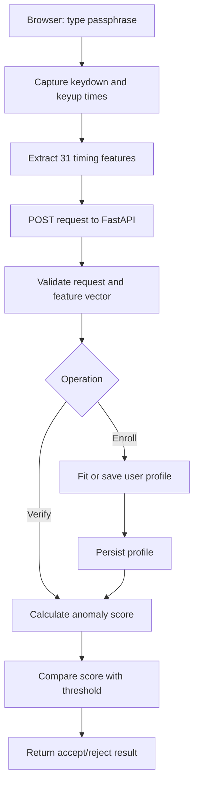

# Keyro — Keystroke Dynamics Authentication

[](https://www.python.org/downloads/)
[](https://fastapi.tiangolo.com/)
[](https://scikit-learn.org/)
[](LICENSE)

Keyro is a research/demo application for **keystroke-dynamics verification**. It measures the timing of a user typing a fixed passphrase and compares those measurements with a previously enrolled profile. The project combines a browser-based interface, a FastAPI backend, and anomaly-detection models.

> **Important:** Keyro is a prototype, not a production-ready authentication system. Timing patterns are probabilistic signals, not proof of identity. Do not use this project as the sole control protecting real accounts, payments, or sensitive data.

## Contents

- [How it works](#how-it-works)
- [Dataset](#dataset)
- [Feature extraction](#feature-extraction)
- [Models and evaluation](#models-and-evaluation)
- [Reported benchmark results](#reported-benchmark-results)
- [Architecture](#architecture)
- [Web application](#web-application)
- [API reference](#api-reference)
- [Project structure](#project-structure)
- [Setup and run](#setup-and-run)
- [Tests](#tests)
- [Security and limitations](#security-and-limitations)
- [Research reference and license](#research-reference-and-license)

## How it works

1. A user types the benchmark passphrase, `.tie5Roanl`, in the browser.
2. The browser records keydown and keyup event times and derives a 31-value timing vector.
3. During enrollment, the backend fits or stores a profile using repeated samples.
4. During verification, the backend scores a new sample against the enrolled profile.
5. The score is compared with a threshold to return an accept/reject decision.

The passphrase is fixed for compatibility with the research dataset. This is a benchmark constraint, not a recommendation for real authentication products.

## Dataset

The benchmark is based on the **CMU Keystroke Dynamics Benchmark**, commonly distributed as `DSL-StrongPasswordData.csv`.

- **Research paper:** Killourhy, K. S., and Maxion, R. A. (2009), *Comparing anomaly-detection algorithms for keystroke dynamics*.
- **Subjects:** 51 typists.
- **Attempts:** 400 repetitions per subject in the commonly used benchmark file.
- **Passphrase:** `.tie5Roanl`, followed by Return.
- **Features:** 31 timing measurements per attempt, plus subject/repetition/session metadata.

The benchmark contains repeated samples from a fixed typing task. Results on this dataset do **not** establish performance against skilled, adaptive, replay, or synthetic-input attackers in the wild.

If the dataset is not present locally, check `data/download_dataset.py` for the project's download and validation workflow. Confirm the dataset's source and license before redistributing it.

## Feature extraction

Keyro derives 31 timing features from the sequence of key events:

| Feature family | Count | Meaning |
|---|---:|---|
| Hold times | 11 | Time between keydown and keyup for each key, including Return |
| Down–down flight times | 10 | Time between keydown events for adjacent keys |
| Up–down flight times | 10 | Time from releasing one key to pressing the next |

For a key \(k\), its hold time is:

\[
H_k = t_{\mathrm{up}}(k) - t_{\mathrm{down}}(k)
\]

For adjacent keys \(k_1\) and \(k_2\):

\[
DD_{k_1,k_2} = t_{\mathrm{down}}(k_2) - t_{\mathrm{down}}(k_1)
\]

\[
UD_{k_1,k_2} = t_{\mathrm{down}}(k_2) - t_{\mathrm{up}}(k_1)
\]

When the events are captured consistently, \(DD_{k_1,k_2}=H_{k_1}+UD_{k_1,k_2}\). Browser event timing is not a trusted hardware measurement: operating-system scheduling, browser behavior, keyboard hardware, and input injection can affect the values.

## Models and evaluation

The project compares three anomaly-scoring approaches:

- **One-Class SVM (RBF):** Learns a boundary from genuine enrollment samples. The reported configuration uses `nu=0.05` and `gamma="scale"`.
- **Scaled Manhattan baseline:** Computes a normalized L1 distance from the genuine-sample mean, using per-feature standard deviations.
- **Isolation Forest:** Uses randomized trees to identify samples that are easier to isolate from the training distribution.

The models produce scores; the application uses a threshold to make an accept/reject decision. Score direction and threshold semantics must remain consistent between training, evaluation, and the live API.

### Metrics

- **False Acceptance Rate (FAR):** Fraction of impostor attempts incorrectly accepted.
- **False Rejection Rate (FRR):** Fraction of genuine attempts incorrectly rejected.
- **Equal Error Rate (EER):** Error rate at the threshold where FAR and FRR are equal or closest, depending on the implementation.
- **ROC AUC:** Measures ranking/discrimination across thresholds; it does not identify a production operating threshold.
- **DET curve:** Plots the trade-off between false rejection and false acceptance, commonly on transformed axes.

Lower FAR and FRR are desirable, but reducing one can increase the other. A threshold should be chosen for a clearly defined use case and validated on data not used to tune it.

### Benchmark protocol

The project README's reported protocol uses, for each target subject:

- The first 200 repetitions as genuine training samples.
- The remaining 200 repetitions as genuine test samples.
- Five test repetitions from each of the other 50 subjects as impostor attempts.

That gives 200 genuine test attempts and 250 impostor attempts per target subject, or 450 test attempts per subject. Across 51 target subjects, that is 22,950 subject-level evaluation trials.

This split should be checked against `ml/dataset.py` and `ml/benchmark.py` before treating it as a reproducible research result. In particular, confirm that preprocessing, threshold selection, and any model selection do not use test data.

## Reported benchmark results

The values below are **the results reported in the project's existing documentation**. Re-run the benchmark and inspect the generated JSON before relying on them in a presentation, paper, or release.

| Model | Mean EER | Std. dev. of EER | Median EER | Mean ROC AUC |
|---|---:|---:|---:|---:|
| One-Class SVM (RBF) | 14.12% | 9.54% | 11.35% | 0.9113 |
| Scaled Manhattan | 14.34% | 10.21% | 11.80% | 0.9118 |
| Isolation Forest | 15.15% | 9.97% | 12.85% | 0.9097 |

**Interpretation:** The reported mean EER is lowest for One-Class SVM, while the reported mean AUC is slightly higher for the Scaled Manhattan baseline. Therefore, the results do not show that One-Class SVM is best on every metric. The differences should be interpreted with per-subject results and uncertainty in mind.

If the benchmark script creates these files, review them after running it:

- `results/roc_curves.png`
- `results/det_curves.png`
- `results/model_comparison.png`
- `results/benchmark_summary.json`
- `results/best_model_config.json`

File availability and exact contents depend on the current repository checkout and whether the benchmark has been run.

## Architecture



The browser provides the input measurements, while the backend validates requests and performs the model/scoring workflow. Client-generated timestamps must be treated as untrusted input.

## Web application

The interface is described as a responsive single-page application served from `app/static/`.

The documented workflows include:

- **Enrollment:** Register a username and submit repeated passphrase samples.
- **Verification:** Submit one new sample and view the decision and score.
- **Threshold adjustment:** Explore how a threshold changes accept/reject behavior. Any live FAR/FRR display should be understood as illustrative unless it is calculated from a clearly defined evaluation set.
- **Impersonation demo:** Compare attempts from different typists using the same passphrase.
- **Feature deviations:** Inspect timing features that differ from the enrolled profile.

Verify that each workflow is implemented in the current checkout before presenting it as a working feature.

## API reference

The following routes are documented by the project. Confirm exact request and response schemas in `app/main.py` and `app/schemas.py`, or inspect the running API at `/docs`.

| Method | Endpoint | Purpose |
|---|---|---|
| `GET` | `/health` | Health/status response |
| `GET` | `/` | Serves the web interface |
| `POST` | `/enroll` | Enrolls a profile from repeated feature samples |
| `POST` | `/verify` | Scores one attempt for an enrolled profile |
| `GET` | `/users` | Lists enrolled profiles |
| `GET` | `/benchmark/summary` | Returns benchmark summary data |
| `GET` | `/audit/logs` | Returns verification history |

Interactive API documentation is normally available at `http://127.0.0.1:8000/docs` when the server is running. Endpoint availability and payload details depend on the current code.

## Project structure

The following is the structure documented for the project; files may differ in the current repository checkout.

```text
Keyro/
├── requirements.txt
├── README.md
├── REPORT.md
├── app/
│   ├── main.py
│   ├── config.py
│   ├── schemas.py
│   ├── feature_extractor.py
│   ├── storage.py
│   ├── model_service.py
│   └── static/
│       ├── index.html
│       ├── css/
│       │   └── style.css
│       └── js/
│           ├── keystroke.js
│           └── app.js
├── data/
│   ├── download_dataset.py
│   └── DSL-StrongPasswordData.csv
├── ml/
│   ├── dataset.py
│   ├── models.py
│   ├── evaluate.py
│   ├── benchmark.py
│   └── benchmark.ipynb
├── results/
│   ├── roc_curves.png
│   ├── det_curves.png
│   ├── model_comparison.png
│   ├── benchmark_summary.json
│   └── best_model_config.json
├── storage/
│   ├── users.json
│   ├── verification_logs.json
│   └── models/
└── tests/
    ├── test_feature_extractor.py
    ├── test_models.py
    └── test_api.py
```

Do not commit real user profiles, verification logs, secrets, or other sensitive runtime data to version control.

## Setup and run

### Prerequisites

- Python 3.10 or newer
- Git
- A modern browser with keyboard-event support

### 1. Clone the repository

```bash
git clone https://github.com/Pranav-Pardeshii/Keyro.git
cd Keyro
```

### 2. Create a virtual environment

**Windows (PowerShell):**

```powershell
py -m venv .venv
.\.venv\Scripts\Activate.ps1
python -m pip install --upgrade pip
pip install -r requirements.txt
```

**macOS/Linux:**

```bash
python3 -m venv .venv
source .venv/bin/activate
python -m pip install --upgrade pip
pip install -r requirements.txt
```

### 3. Run the benchmark (optional)

Make sure the benchmark dataset is present at the path expected by the project, then run:

```bash
python ml/benchmark.py
```

This should run the configured benchmark pipeline and write its outputs to `results/`, if the current implementation is set up to do so. If it fails, follow the error message and inspect the dataset path and dependencies.

### 4. Start the web server

From the repository root, run:

```bash
uvicorn app.main:app --reload --host 127.0.0.1 --port 8000
```

Open [http://127.0.0.1:8000](http://127.0.0.1:8000). API documentation, if enabled, is available at [http://127.0.0.1:8000/docs](http://127.0.0.1:8000/docs).

Binding to `127.0.0.1` keeps the development server accessible only from the local machine. Do not expose the development server publicly without appropriate deployment hardening.

## Tests

Run the test suite from the repository root:

```bash
python -m pytest tests/ -v
```

The original README lists 18 tests. Treat that count as historical documentation, not a guarantee that every test currently passes. Use the actual test output from your checkout as the source of truth.

## Security and limitations

Before using Keyro beyond a local demo, account for these limitations:

1. **Not a standalone factor:** Typing rhythm can be copied, replayed, or manipulated. Combine it with established authentication controls rather than replacing passwords, passkeys, or MFA.
2. **Client-side timestamps are untrusted:** A compromised client can fabricate events or submit a crafted feature vector. Server-side validation alone cannot prove the measurements came from a physical user.
3. **Fixed, public passphrase:** The benchmark passphrase is known and unsuitable as a real secret. Do not reuse it for actual accounts.
4. **Device and context variation:** Keyboard layout, hardware, browser, posture, fatigue, stress, accessibility needs, and other factors can change timing patterns. Test cross-session and cross-device behavior.
5. **Threshold trade-offs:** A threshold that reduces false accepts may increase false rejects. Choose thresholds using an appropriate validation set and report the operating point.
6. **Enrollment and model drift:** Too few enrollment samples can produce an unstable profile; behavior can also change over time. Any adaptive update mechanism needs safeguards against profile poisoning.
7. **Data protection:** Biometric timing profiles and authentication logs can be sensitive. Limit collection, restrict access, define retention, and avoid storing unnecessary personal data.
8. **Local JSON storage:** If the current implementation uses JSON files for profiles and logs, this is a simple demo persistence mechanism—not a hardened multi-user production datastore. Protect files and account for concurrent writes, access control, backups, and deletion.
9. **No production security claim:** Benchmark performance on one fixed typing task does not demonstrate resistance to targeted attackers or prove real-world identity.

## Research reference and license

Killourhy, K. S., and Maxion, R. A. (2009). “Comparing anomaly-detection algorithms for keystroke dynamics.” *2009 IEEE/IFIP International Conference on Dependable Systems & Networks*, pp. 125–134.

```bibtex
@inproceedings{killourhy2009comparing,
  title     = {Comparing anomaly-detection algorithms for keystroke dynamics},
  author    = {Killourhy, Kevin S. and Maxion, Roy A.},
  booktitle = {2009 IEEE/IFIP International Conference on Dependable Systems and Networks},
  pages     = {125--134},
  year      = {2009},
  organization = {IEEE}
}
```

This project states that it is released under the MIT License. See [`LICENSE`](LICENSE) in the repository for the actual license text.
